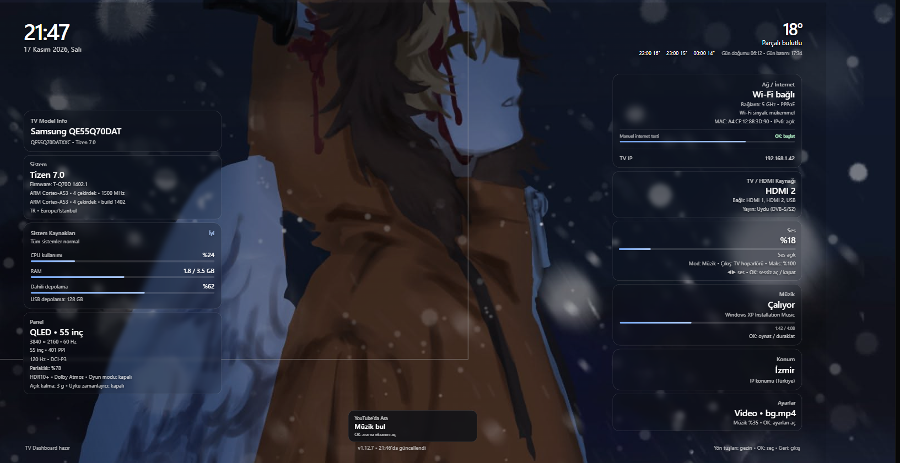
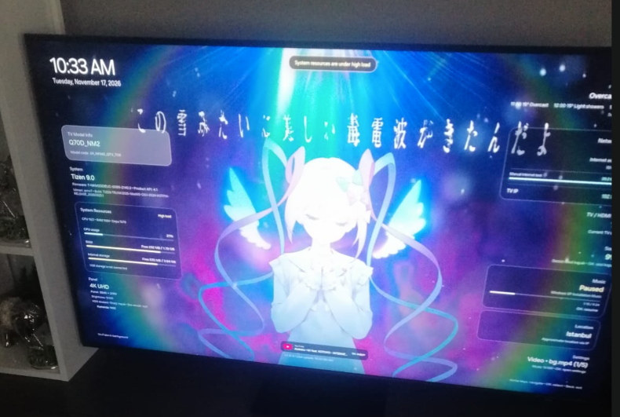

# TV Dashboard

A system information panel for Samsung Tizen TVs. Shows the clock, weather,
network details, source and panel information, and a background media player.
Fully navigable with the TV remote.

## Interface layout

```
┌──────────────────────────────────────────────────────────────┐
│  21:47          18°  Partly cloudy        (background video) │
│  9 October 2026  ☀ 06:12 ↓ 17:34                            │
├────────────────────┬────────────────────┬────────────────────┤
│ Left column        │ Middle column      │ Right column       │
│ • TV model info    │ • YouTube search   │ • Network/Internet │
│ • System           │ • YouTube player   │ • TV / HDMI source │
│ • System resources │ • Now-playing card │ • Sound            │
│ • Panel            │                    │ • Music            │
│                    │                    │ • Location         │
│                    │                    │ • Settings         │
└────────────────────┴────────────────────┴────────────────────┘
```

## Screenshots





<!-- More screenshots can be added here as docs/screenshots/dashboard-3.png -->

## Installation

**Requirements:** Visual Studio Code with the **Tizen Extension**
(`vscode-tizen-csharp`, version 10.x). It manages its own SDK, so nothing
else needs to be installed. Tizen Studio itself is retired and no longer
distributed.

The TV must have "Allow unsigned installation" enabled.

Open this folder in VS Code and use the Tizen Extension sidebar:

1. **Actions → Build Project** — compiles the `.wgt`
2. **Actions → Run Project** — installs it on the TV and launches it

**See [INSTALLING.md](INSTALLING.md)** for the full tutorial: opening the
project in VS Code, setting up the signing certificate, running the TV web
simulator, debugging on a real TV, and troubleshooting.

## Remote control

| Key | Action |
|---|---|
| Arrow keys | Move between cards (nearest card in that direction wins) |
| OK | Open the focused card / play-pause |
| Back | Exit the app / close the YouTube overlay |
| Play / Pause | Play or pause the active YouTube video, otherwise the music |
| Volume up/down/mute | Adjust TV volume and mute |

On the Sound card, OK toggles mute. The Location card is display-only. When a
YouTube video is active, Play/Pause and Back control it; the on-screen overlay
also works with the remote (arrows to move, OK to select, Back to close).

## Architecture

No framework, no build system. `index.html` + `style.css` + `main.js`
(one file, ~4300 lines) plus the `config.xml` manifest.

Three separate data sources are used:

1. **Samsung Product API** (`$WEBAPIS/webapis/webapis.js`) — model, firmware,
   panel/resolution, connection type, TV IP, board temperature, remote battery,
   sound, HDR/energy, HDMI sources.
2. **Tizen core API** (`tizen.systeminfo`) — CPU load, RAM, internal/USB
   storage. Also `tizen.application`, `tizen.tvinputdevice`,
   `webapis.avplay`, `webapis.appcommon`.
3. **Public web APIs** — Open-Meteo (weather),
   geojs / ipwho.is (IP location), speed.cloudflare.com (speed test),
   Piped (`api.piped.private.coffee`) for YouTube search and stream metadata.

### Background playback

Three layers with fallback:

```
avplay  →  <video>  →  
```

If playback fails, it retries after 2/5/15/30 seconds. The screen saver is
disabled automatically while media is playing.

### Background media and music

Background media and music are read from the app's own folder rather than
hard-coded, so you can supply your own files. The app scans the installed
package at startup and rebuilds both lists on every launch — there is no
import step, and the only action needed on your side is rebuilding the
package.

#### Backgrounds

The filename **must** begin with `bg` — the filter is `/^bg\d*\./i`. Everything
else about the name is free: `bg.mp4`, `bg2.mp4`, `bg10.mp4` and `bg-party.mp4`
are all picked up.

| | Accepted | Notes |
|---|---|---|
| Images | jpg, jpeg, png, webp | Still-image background |
| Videos | mp4 | Played with `avplay`, then `<video>` |

**How to add one**

1. Put the file in the project root, next to `index.html` — for example
   `bg6.mp4`.
2. **Build Project** and **Run Project** as usual.
3. Open **Settings** on the TV: *Photo selection* or *Video selection* lists the
   new file, and `←` / `→` cycles through it. OK saves.

Numbering does not have to be contiguous. The list is ordered by the number in
the name — plain `bg` sorts first, then `bg2`, `bg3` and so on — not
alphabetically, so `bg10.mp4` correctly comes after `bg5.mp4`. A name with no
number, such as `bg-party.mp4`, is treated as `bg2` and therefore sits
alongside it.

> **Naming is the whole rule.** A file called `holiday.mp4` is ignored silently:
> no error, it just does not appear in the list. If a file you added is
> missing, check that it starts with `bg`.

> **Size matters.** Backgrounds are packaged into the `.wgt` and pushed over
> the network on every install. The shipped backgrounds total about 15 MB
> (20 MB including the music); adding a large 1080p clip adds its full size
> to the package and to install time.

Video backgrounds also need the codec to be H.264 (`avc1`) with `yuv420p`
pixel format, which is what the Tizen video pipeline expects. Anything else may
show the still-image fallback instead.

#### Music

Any file whose name starts with **`music`** is picked up, and the Music
selection row in Settings lists the tracks.

| | Accepted |
|---|---|
| Audio | mp3, m4a, aac, ogg, wav |

**How to add one**

1. Put the file in the project root, next to `index.html` — for example
   `music2.mp3`.
2. **Build Project** and **Run Project**.
3. Open **Settings → Music selection** and use `←` / `→` to choose the track.
   OK saves.

Unlike backgrounds there is no numeric naming rule; tracks are ordered by
name, with numbers compared numerically so `music2` comes before `music10`.
Naming still matters — a file called `song.mp3` is ignored silently and never
appears in the list.

Switching tracks mid-song keeps playing and resumes at roughly the same
position. The chosen track is stored in `localStorage` and restored on the
next launch.

> **Size matters.** Backgrounds and music are packaged into the `.wgt` and
> pushed over the network on every install. The shipped media totals about
> 20 MB, so extra files add their full size to the package and to install
> time. Audio is already compressed; re-encoding usually saves little.

### YouTube

Search and metadata come straight from Piped
(`api.piped.private.coffee`) on each TV — no proxy. Video bytes are streamed
from Piped's proxy / Googlevideo directly to the TV. Only the small embed HTML
page passes through a relay, which exists because the Tizen app runs on a
`file://` origin that YouTube rejects for autoplay.

The embed falls back through this chain, skipping dead addresses:

```
selected/active relays  →  Piped embed  →  youtube-nocookie  →  youtube.com
```

Settings → **YouTube relay** picks the active source:

- **Otomatik** — try the public relay, then the fallbacks.
- **Yedek relay** — force the community backup relay.

If the relay is down, a video that is already playing keeps running; only
opening a *new* video is affected, and it automatically drops to the next
fallback. No account, Cloudflare Worker or personal domain is required — the
app works for anyone who installs it. The `youtube-relay/` folder is only an
optional reference implementation and is not needed at runtime.

### Performance

`PERFORMANCE` constants: clock 60 s, system 30 s, sources 2 min, storage
5 min, slow values 10 min. When the app is hidden, all timers stop, media
pauses and the screen saver is enabled.

A pixel-shift timer runs every 4 minutes to reduce burn-in on OLED panels.
It is registered in `runtimeIntervals`, so it stops together with the other
timers.

### Location

IP geolocation is approximate — it reports the city the ISP registered the
address in, not necessarily where the TV is. The card shows that value and
the source it came from, and nothing else; there is no manual override.

Forecast times are requested as Unix timestamps (`timeformat=unixtime`) and
compared against `Date.now()`, so the displayed hours do not depend on the
TV's own timezone. `utc_offset_seconds` from the response is used to render
each time in the location's local time.

### Internationalisation

TR and EN. Static strings live in `I18N`, dynamic ones in `EN_DYNAMIC`.
The choice is persisted in `localStorage` and can be changed later from the
Settings panel.

### Glass theme

Cards, overlays and buttons share one material. The base surface is
`rgba(14, 17, 25, 0.46)` with `backdrop-filter: blur(14px)`; secondary cards
use a thinner variant at 0.30 with 10px blur. Overlay backdrops use a single
scrim (`rgba(0, 0, 0, 0.52)` plus 3px blur) for all three dialogs.

Focus and selected states brighten the surface and brighten the border —
they never change hue.

### Background media files

Packaged media is scanned with `tizen.filesystem.resolve("wgt-package")`
(`scanPackagedMedia`). Files matching the `bg` prefix are collected as
images and videos; when the scan fails, the built-in list is used.

Videos are 1920x1080 at 30 fps, H.264, audio stripped. The original 193 MB
set was re-encoded down to the current ~20 MB including music.

## Development tools

All checks are plain Node scripts with no dependencies. Run them before
committing:

```bash
node tools/smoke.mjs             # boots the app against a DOM/Tizen stub, exercises remote keys
node tools/check-i18n.mjs        # EN coverage for literals + mojibake scan
node tools/check-html-i18n.mjs   # untranslated Turkish text in index.html
node tools/check-css.mjs         # undefined and unused CSS classes
node tools/check-installing.mjs  # INSTALLING.md claims vs. manifest and files
node tools/check-links.mjs       # relative links and asset paths
node tools/check-location.mjs    # IP-only location flow
node tools/check-media-docs.mjs  # media scan rules vs. README
node tools/check-metadata.mjs bg.mp4 icon.png  # embedded metadata in media
node tools/check-music.mjs       # music selection flow
node tools/check-version.mjs     # version agreement across manifest, HTML and JS
node tools/find-unused-media.mjs # packaged files not referenced anywhere
node tools/scan-secrets.mjs      # secrets/PII across all commits (text files only)
```

`check-i18n.mjs` collects the Turkish literals passed to `setText`,
`setStatus`, `setYoutubeMessage` and `updateFooter`, reports the ones missing
from `EN_DYNAMIC`, and also fails on mojibake such as `artırıldı`.
`smoke.mjs` parses `main.js`, runs `boot()` with a stubbed DOM, exercises the
language/settings and remote-key flows, and checks for dead functions and for
element ids that no longer exist in the HTML.

The relay has its own dependency-free test suite:

```bash
node --test youtube-relay/test/*.test.mjs
```

## Security

`.gitignore` excludes the Samsung Tizen signing certificate and keys
(`*.p12`, `*.pfx`, `*.pem`, `*.key`, `device-profile.xml`,
`author-signature.xml`). `dist/` and `.buildResult/` are ignored too —
`dist/device-profile.xml` contains the developer email and an X.509
certificate.

Without that certificate the app only runs on TVs with unsigned installation
enabled; use your own certificate for Samsung Store distribution. The widget
`id` in `config.xml` uses a local domain for sideloading; replace it with a
domain you own before submitting to the store.

## Directory layout

```
config.xml          Tizen manifest (permissions, origins, app identity)
index.html          Single page interface
main.js             All application logic
style.css           Interface styles
INSTALLING.md       Installation tutorial
bg*.mp4 / bg*.jpg   Background media files (1080p30, compressed)
music-tv.mp3        Bundled music
tools/              Maintenance and verification scripts
youtube-relay/      Optional reference relay (not needed at runtime)
```

No build system is needed for the app itself. `youtube-relay/` is only an
optional reference; the dashboard does not depend on it.

## License

Personal use. The Samsung Tizen SDK and the background media shown in the
screenshot belong to their respective owners.